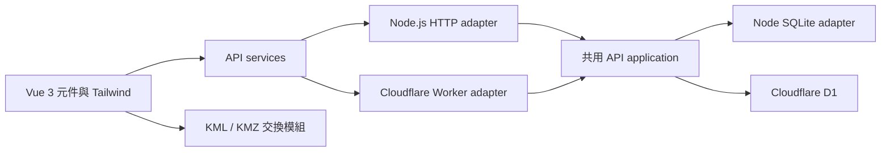

# Event Atlas 架構

這是獨立的事件地圖網站，目錄為 `/Users/lanyanlin/Desktop/event-atlas`；不修改旁邊的 GeoPort 專案。

## 執行方式

Vue 3 + Vite + Tailwind CSS 提供前端。Node.js 原生 HTTP server 與 Cloudflare Worker 共用同一套 API、輸入驗證及業務邏輯，沒有第二套 CRUD 或權限規則。Node.js 可獨立執行及部署；目前正式站繼續使用 GitHub Pages + Cloudflare Workers / D1，沒有搬走或複製正式資料。

## 檔案職責

| 目錄 | 職責 |
| --- | --- |
| `src/App.vue` | 組合總覽、專案工作區、對話框及圖層入口 |
| `src/components/` | 時間軸、閱讀器、表單、地圖圖層及標註等畫面 |
| `src/composables/useAtlasWorkspace.js` | 專案路由、資料同步、表單儲存及事件導覽的協調 |
| `src/composables/useProjectMap.js` | 專案 Leaflet 地圖、標記與尺寸／生命週期管理 |
| `src/composables/workspaceContext.js` | 單一工作區內的 Vue provide / inject 狀態，不使用跨頁隱含單例 |
| `src/services/api.js` | API 與媒體 URL、分頁讀取 |
| `src/lib/` | 時間排序、媒體辨識及地圖共用控制 |
| `src/styles/` | Tailwind、設計 token、基礎控制、工作區及閱讀樣式 |
| `shared/` | 跨前後端幾何驗證、事件類型、KML / KMZ 格式 |
| `server/app.js` | 兩個 runtime 共用的 API application |
| `server/node.js` | Node HTTP／靜態檔入口、設定與請求上限 |
| `server/database.js` | SQLite migration、D1 相容參數綁定介面及原子交易 |
| `server/public-fetch.js` | Node 公開 HTTPS transport，DNS 驗證後固定 IP 連線 |
| `worker/index.js` | Cloudflare 正式部署入口 |
| `migrations/` | 共用的資料表版本變更，不重建既有資料 |
| `tests/` | 權限、驗證、格式、Node HTTP、串流與瀏覽器流程 |

## 介面規則

桌機左側只放事件紀錄與新增入口。事件是必要圖層，始終顯示；日期／類型仍可篩選事件。地圖沒有瀏覽／事件模式工具列，選點新增由時間軸的「地圖選點新增事件」進入。

地圖右上「圖層」統一控制底圖與可選標註。標註預設收起，開啟後可點圖形顯示資訊；「管理標註」在地圖側開啟圖卡、繪製、匯入和匯出。手機保留地圖／時間軸切換，標註資訊在地圖上按需出現。專案範圍與縮放共用同一組控制，沒有額外圖例。

## KML / KMZ

標註 UI 使用 KML 與 KMZ；API 內部維持既有 GeoJSON 幾何，既有資料無須轉檔或重建。KML 2 MB、KMZ 5 MB，ZIP 最多 32 條目、解壓最多 8 MB；單次最多 100 筆、每筆 2000 座標、總 10000 座標，轉換後 API 資料最多 480 KB。先預覽名稱與類型，通過管理員與網站驗證才儲存。

保留名稱、說明、Point、LineString、Polygon 及內環。MultiGeometry 拆成編號圖卡。匯出校正 KML 外框／內環方向，不改寫資料。高程、樣式及附件不匯入；NetworkLink、Overlay、Model、Track、Tour 等整份拒絕，不默默遺失圖層，也不下載外部資源。DTD、自訂實體、損壞或不安全的 ZIP 路徑、壓縮炸彈均拒絕。

匯出涵蓋整個專案的有效標註，不受單次匯入筆數限制；超過匯入上限的大檔再匯入時需先分批。專案 JSON 是完整紀錄備份，與地圖標註 KML／KMZ 交換分開。

## 資料與安全

Node SQLite 自動執行尚未套用的 migration，已套用者不重複執行；外鍵與批次交易保留照片、事件、標註關聯。`data/`、`.local/`、環境檔與所有金鑰均排除於 Git。

Node 正式環境不允許 Local Dev 略過網站驗證，HTTP Host 不能改變設定的公開 origin。外部 PDF／媒體經每次 DNS 全結果檢查、IP 固定與 TLS 原站驗證，重新導向逐次驗證。PDF 維持 Range、大小限制及串流；不將私網連線或整份 PDF 緩衝帶到 Node 部署。

以 KML／KMZ 匯入的說明視為純文字，Vue 轉義後顯示，不執行其中的 HTML。原有管理員金鑰不保存到 localStorage，不增加新登入方式。

## 底圖與外部資料圖層

`src/config/externalLayers.js` 是外部服務登錄；`useMapLayers` 管理底圖互斥、外部圖層的開關、串流圖磚載入狀態、錯誤／重試與不透明度。各地圖實例獨立管理自己的 layer，離開時移除 layer 和計時器。可登錄 WMS 或 XYZ URL，不將來源 URL 交給任意後端代理。

第一個來源為官方 1:50,000 臺灣地質圖。WMS 提供 EPSG:4326，由 Leaflet 為目前視窗產生正確的經緯度 BBOX；不把不支援的 EPSG:3857 傳給來源。此影像服務沒有 CORS，僅作顯示，不啟用匿名 crossOrigin 或宣稱可讀取影像像素。詳見 [官方來源與驗證紀錄](geology-source.md)。

底圖使用 radio，基本地圖與衛星影像擇一；資料圖層是可疊加的 checkbox。事件沒有隱藏開關，標註及地質圖預設關閉，地質圖顯示來源、1:50,000 比例尺及不透明度。圖層失敗不隱藏事件，可以重試或關閉。外部資料只在地圖顯示，不儲存到專案、也不加入 KML／KMZ 標註匯出。
